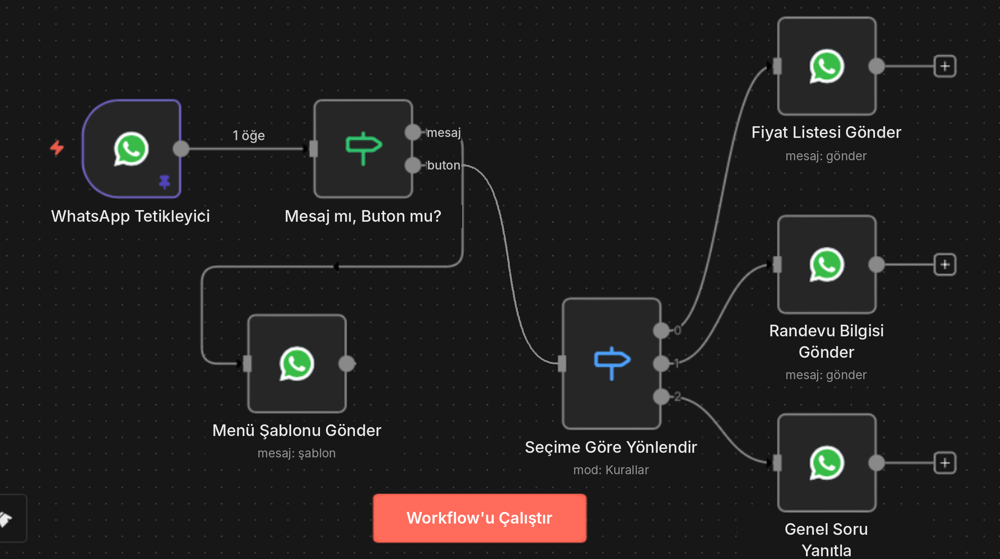

# 4 · İlk workflow'unu oluştur

## 4.1 Temel kavramlar

| Kavram | Anlamı | Örnek |
|---|---|---|
| **Workflow (iş akışı)** | Birbirine bağlı adımlardan oluşan otomasyon | "Form gelince e-posta at ve tabloya yaz" |
| **Düğüm (node)** | Workflow'daki tek bir adım; her kutu bir iş yapar | Gmail, Google Sheets, HTTP Request, AI Agent |
| **Tetikleyici (trigger)** | Workflow'u başlatan olay; her workflow bir tetikleyiciyle başlar | Yeni WhatsApp mesajı, zamanlayıcı, webhook |
| **Öğe (item)** | Düğümler arasında akan veri parçası (JSON) | Bir mesaj, bir satır, bir müşteri |
| **İfade (expression)** | Önceki düğümün verisini kullanmak | `{{ $json.email }}` |
| **Kimlik bilgisi (credential)** | Bir servise bağlanmak için kaydedilen anahtar/token | OpenAI API anahtarı |
| **Execution (çalıştırma)** | Workflow'un bir kez çalışması | Her gelen mesaj = 1 execution |

## 4.2 Arayüzde ilk adımlar

1. n8n'de **Overview → Create Workflow**. Karşına boş bir tuval ve **"Add first step…"** kutusu çıkar.
2. Sağ üstteki **+** butonuna (veya ortadaki kutuya) tıkla. "What triggers this workflow?" paneli açılır:

| Tetikleyici | Ne zaman kullanılır |
|---|---|
| **Trigger manually** | Test ederken; butona basınca çalışır |
| **On app event** | Telegram, WhatsApp, Notion, Airtable gibi bir uygulamada olay olunca |
| **On a schedule** | Her gün / saat / belirli aralıklarla |
| **On webhook call** | Dışarıdan bir HTTP isteği gelince |
| **On form submission** | n8n'in kendi formu doldurulunca |
| **On chat message** | AI sohbet akışları için |

## 4.3 Alıştırma: Her sabah AI'dan günün motivasyon mesajı

Hiçbir dış hesap gerektirmeyen bir başlangıç örneği:

1. **On a schedule** → Her gün 09:00
2. **+** → **AI Agent** (veya OpenAI düğümü) → OpenAI/Anthropic kimlik bilgini ekle → prompt: `Bir küçük işletme sahibi için 1 cümlelik Türkçe motivasyon mesajı yaz.`
3. **+** → **Send Email** / **Telegram** / **Slack** → metin alanına `{{ $json.output }}` (AI düğümünün çıktı alanı; kendi çıktında hangi alan olduğunu kontrol et)
4. Üstteki **Execute workflow** ile test et, her düğümün altındaki çıktıyı incele.
5. Sağ üstten **Save** → **Active** anahtarını aç. Artık her sabah kendi kendine çalışır.

## 4.4 Örnek: Gerçek bir workflow nasıl görünür?

Aşağıdaki workflow, gelen bir mesajın türüne bakıp iki farklı yola ayrılıyor; bir yolda menü gönderiyor, diğerinde seçime göre üç farklı dala yönlendiriyor. Her kutu bir düğüm, çizgiler verinin akış yönü.

Okuma sırası: **soldan sağa**. Tetikleyici → karar düğümü (IF) → işlem düğümleri. Karar düğümlerinin (IF, Switch) birden fazla çıkışı vardır; her çıkış farklı bir yola gider.

## 4.5 İfadeler (expressions) kısa rehber

| İfade | Ne verir |
|---|---|
| `{{ $json.alan }}` | Bir önceki düğümden gelen alan |
| `{{ $('Düğüm Adı').item.json.alan }}` | Belirli bir düğümün verisi |
| `{{ $now.toFormat('dd.MM.yyyy') }}` | Bugünün tarihi |
| `{{ $json.metin.toUpperCase() }}` | JavaScript yöntemleri kullanılabilir |
| `{{ $json.a?.b ?? 'yok' }}` | Alan yoksa hata yerine varsayılan değer |

## 4.6 İyi alışkanlıklar

- **Düğümleri Türkçe ve anlamlı adlandır** ("Mesaj mı, Buton mu?" gibi). Üç ay sonra kendin teşekkür edeceksin.
- **Test verisini sabitle (pin):** Tetikleyiciden gelen örnek veriyi pinle, her testte tekrar mesaj atmak zorunda kalma.
- **Hata workflow'u kur:** Settings → Error workflow ile bir workflow hata verince sana bildirim gelsin.
- **Executions** sekmesinden geçmiş çalıştırmaları ve hataları incele.

Resmi kaynaklar: [n8n dokümantasyonu](https://docs.n8n.io) · n8n ücretsiz kurslar (docs.n8n.io → Courses) · [n8n topluluk forumu](https://community.n8n.io)

---
[← Sunucuya n8n kurulumu](03-n8n-kurulum.md) · [Sonraki: API'ler ve kimlik bilgileri →](05-apiler-ve-kimlik-bilgileri.md)
