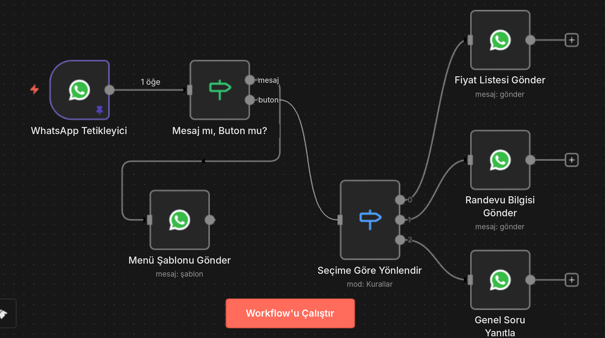

# 5 · WhatsApp asistanı

İşletmeye gelen WhatsApp mesajlarına 7/24 butonlu bir menüyle cevap veren, müşterinin seçimine göre doğru bilgiyi gönderen sistem.



İçe aktarılabilir dosya: [`workflows/whatsapp-asistan.json`](../workflows/whatsapp-asistan.json)

## 5.1 Nasıl çalışır?

1. Müşteri işletmenin WhatsApp numarasına yazar.
2. **WhatsApp Tetikleyici** mesajı alır.
3. **Mesaj mı, Buton mu?** — Normal bir metin mi geldi, yoksa müşteri bir butona mı bastı?
   - **mesaj** → **Menü Şablonu Gönder**: Butonlu menü gider ("Fiyat Listesi", "Randevu Al", "Genel Soru"). Akış burada biter.
   - **buton** → **Seçime Göre Yönlendir**: Butonun kimliğine göre doğru dala gider.
4. Fiyat listesi, randevu bilgisi veya genel soru yanıtı gönderilir.

## 5.2 En sık yapılan hata: "Akış her seferinde baştan başlıyor"

WhatsApp tetikleyicisi **gelen her olayda** çalışır: normal mesajlarda, buton tıklamalarında, hatta "gönderildi/okundu" durum bildirimlerinde. Sık yapılan kurulum şöyledir:

```
Tetikleyici → Kontrol → Menü Gönder → Switch   ❌
```
Bu yapıda butona basan müşteriye **her seferinde menü tekrar gider**, çünkü buton cevabı da yeni bir mesaj olarak gelir ve önce menü düğümünden geçer.

Doğru yapı iki ayrı yol kullanır:
```
Tetikleyici → Mesaj mı, Buton mu? ─ mesaj ─▶ Menü Gönder (biter)
                                   └ buton ─▶ Seçime Göre Yönlendir → dallar   ✅
```
Butona basıldığında menü düğümü hiç çalışmaz. Tek seviyeli menüler için ayrıca oturum (session) tutmaya gerek yoktur.

## 5.3 Gelen verinin yapısı

Meta'nın webhook verisinde mesaj `messages[0]` altında gelir:

| Durum | `type` | Butonun kimliği |
|---|---|---|
| Normal metin | `text` | — (`text.body` içinde mesaj) |
| Etkileşimli buton (interactive) | `interactive` | `interactive.button_reply.id` |
| Etkileşimli liste | `interactive` | `interactive.list_reply.id` |
| Şablon hızlı yanıt butonu | `button` | `button.payload` (metni: `button.text`) |
| Durum bildirimi (gönderildi/okundu) | `messages` yok, `statuses` var | — |

Kaynak: [Meta · Interactive messages webhook](https://developers.facebook.com/documentation/business-messaging/whatsapp/webhooks/reference/messages/interactive)

Workflow'daki ifade her iki buton türünü de yakalar:
```js
{{ $json.messages?.[0]?.interactive?.button_reply?.id ?? $json.messages?.[0]?.button?.payload ?? '' }}
```
Durum bildirimlerinde `messages` olmadığı için akış "buton" yoluna düşer, Switch hiçbir kurala uymaz ve sessizce biter.

> ⚠️ n8n sürümüne göre tetikleyicinin çıktısı biraz farklı olabilir. İlk test mesajından sonra tetikleyicinin çıktısını açıp alan yollarını kontrol et.

## 5.4 Meta (WhatsApp Cloud API) kurulumu

1. [Meta Business](https://business.facebook.com) hesabı oluştur.
2. [developers.facebook.com](https://developers.facebook.com) → **My Apps → Create App** → **Business** türünde uygulama → **WhatsApp** ürününü ekle.
3. Meta sana test için bir telefon numarası verir. Gerçek kullanımda işletmenin numarasını ekleyip doğrularsın.
4. **Phone number ID** ve **WhatsApp Business Account ID** değerlerini not al.
5. Kalıcı erişim için Business Manager'da bir **System User** oluşturup kalıcı bir **access token** üret (geçici test tokenı 24 saatte biter).

Resmi rehber: [WhatsApp Cloud API · Get started](https://developers.facebook.com/docs/whatsapp/cloud-api/get-started)

## 5.5 n8n kimlik bilgileri

n8n'de iki ayrı kimlik bilgisi gerekir:

| Kimlik bilgisi | Hangi düğüm | Gerekenler |
|---|---|---|
| **WhatsApp API** | Mesaj/şablon gönderen düğümler | Access token, Business Account ID |
| **WhatsApp OAuth API** | WhatsApp Tetikleyici | Meta uygulamasının App ID ve App Secret değerleri |

Kaynak: [n8n dokümantasyonu → Integrations → WhatsApp Business Cloud](https://docs.n8n.io)

## 5.6 Menü şablonunu oluştur

İşletmenin mesaj atmadığı bir kişiye ilk mesajı **onaylı bir şablonla** atabilirsin. Müşteri önce yazdığı için 24 saatlik hizmet penceresi açıktır; bu durumda menü için iki seçenek var:

**A) Şablon + hızlı yanıt butonları (workflow'daki yöntem):**
1. [WhatsApp Manager](https://business.facebook.com) (Meta Business Suite → WhatsApp Manager → Message templates) → **Create template** → kategori **Utility** veya **Marketing**
2. Ad: `menu_sablonu`, dil: Türkçe
3. Gövde: *"Hoş geldiniz! Size nasıl yardımcı olabiliriz?"*
4. Butonlar → **Quick reply**: `Fiyat Listesi`, `Randevu Al`, `Genel Soru`
5. Onaya gönder (genelle kısa sürer).
6. Butonların payload'larını `FIYAT`, `RANDEVU`, `SORU` olarak belirle (şablonu API ile gönderirken buton parametreleriyle verilir). Payload belirtmezsen buton metni gelir; o durumda Switch kurallarını buton metnine göre yaz.

**B) Etkileşimli buton mesajı (şablonsuz):** 24 saat penceresi içindeyken şablon onayı gerekmeden en fazla 3 butonlu mesaj gönderebilirsin. n8n'de **HTTP Request** düğümüyle `POST https://graph.facebook.com/<sürüm>/<PHONE_NUMBER_ID>/messages` adresine `type: "interactive"` gövdesi gönderilir. Butonların `id` değerleri doğrudan `FIYAT`, `RANDEVU`, `SORU` olur. Ayrıntı: [WhatsApp Cloud API dokümantasyonu](https://developers.facebook.com/docs/whatsapp/cloud-api)

## 5.7 Workflow'u içe aktar ve çalıştır

1. n8n → **Overview → Create Workflow** → sağ üst **⋯ → Import from File** → `whatsapp-asistan.json`
2. Her WhatsApp düğümünde kimlik bilgisini seç, `TELEFON_NUMARASI_ID` yerine kendi Phone number ID'ni yaz, şablonu listeden yeniden seç.
3. Mesaj metinlerini işletmeye göre düzenle.
4. Tetikleyiciyi Meta tarafına bağla: n8n tetikleyiciyi aktifleştirdiğinde webhook'u kendisi kaydeder (OAuth kimlik bilgisiyle).
5. Test numarasından mesaj at → menü gelmeli → butona bas → doğru yanıt gelmeli → menü **tekrar gelmemeli**.
6. **Active** anahtarını aç.

> Bu JSON, anlatılan yapının başlangıç şablonudur. n8n sürümleri arasında düğüm ayarları değişebildiği için içe aktardıktan sonra her düğümü açıp kontrol et.

## 5.8 İleri seviye: Çok adımlı konuşmalar

Randevu akışında önce tarih, sonra saat sormak gibi **birden fazla adım** varsa, müşterinin hangi adımda olduğunu hatırlaman gerekir. Model:

```
Tetikleyici → Durumu oku (telefon no) → Switch (duruma göre) → İlgili adım → Durumu güncelle
```

- Anahtar: `messages[0].from` (müşterinin numarası)
- Değer: örn. `{ "adim": "tarih_bekleniyor", "tarih": null }`
- Saklama yeri: n8n **Data Tables** (sürümünde varsa), **Redis** veya **Postgres** düğümleri
- Zaman aşımı ekle: 30 dk cevap gelmezse durumu sıfırla.

## 5.9 Bu workflow'u geliştirmek için fikirler

- **Genel Soru** dalına bir **AI Agent** ekle: işletmenin SSS metniyle eğitilmiş otomatik yanıt.
- Randevuları **Google Calendar**'a yaz, müşteriye onay ve 1 gün önce hatırlatma gönder.
- Her konuşmayı **Google Sheets**/CRM'e kaydet, işletme sahibine günlük özet gönder.

---
[← İlk workflow](04-ilk-workflow.md) · [Sonraki: Hazır şablon kaynakları →](06-hazir-sablonlar.md)
